# Screenshot aplikasi dan keterangannya

Seluruh 45 gambar berasal dari aplikasi yang berjalan pada eksekusi `pnpm test:e2e` mulai 2026-10-01T09:33:03.077Z. Backend yang digunakan adalah Ruby. Gambar teks memakai contoh vektor acuan, sedangkan contoh pesan bebas pada dokumen algoritma berasal dari pengujian API. Kunci dan pesan kedua kelompok dicatat terpisah.

## Gambar 1. 01-tampilan-utama

Tampilan utama memperlihatkan delapan pilihan cipher, operasi enkripsi atau dekripsi, masukan teks atau file, formulir pesan, kunci, dan panel hasil. Badge Mesin Ruby menjelaskan bahwa pesan dan file diproses server.

## Gambar 2. 02-tema-terang

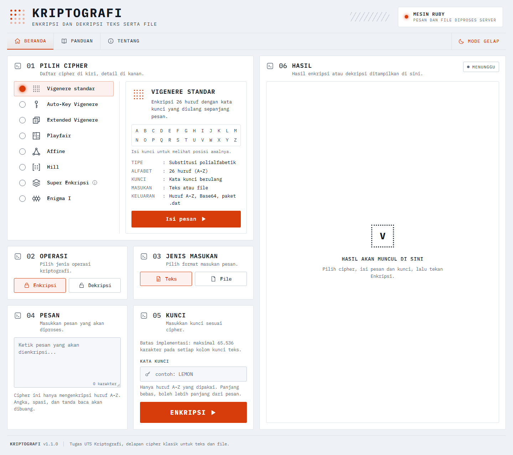

Tampilan utama menggunakan tema terang. Pemilihan tema tetap tersimpan setelah halaman dimuat ulang pada pengujian browser.

## Gambar 3. 03-tema-terang-hasil

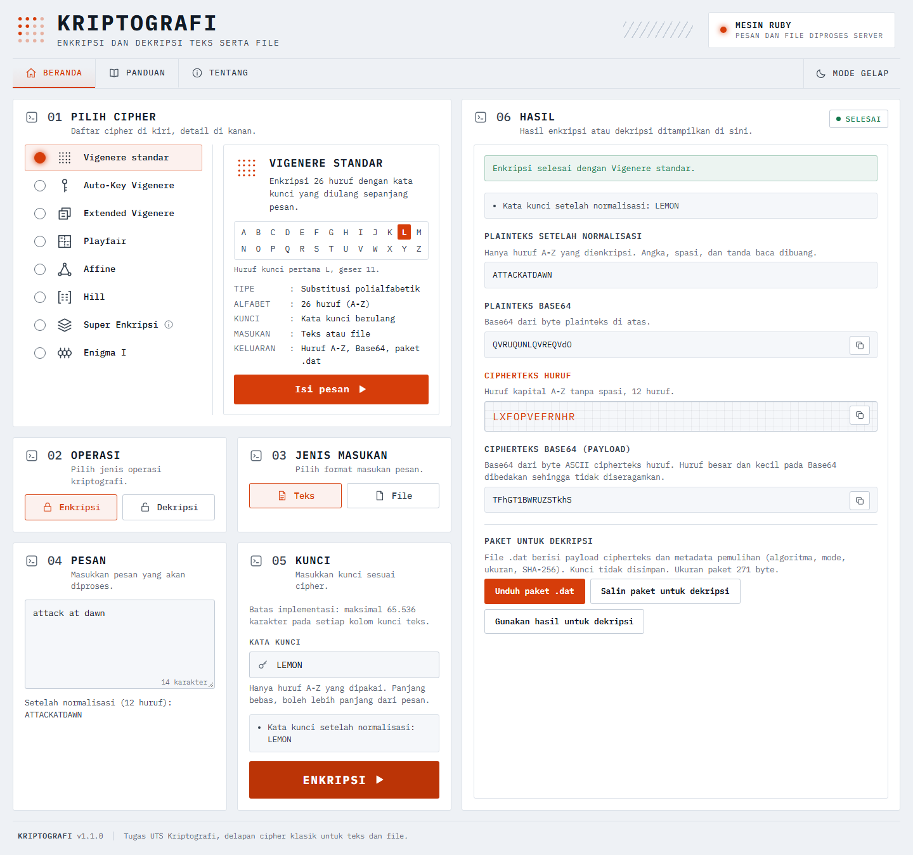

Tema terang menampilkan enkripsi Vigenere untuk attack at dawn dengan kunci LEMON. Cipherteks yang ditampilkan adalah LXFOPVEFRNHR.

## Gambar 4. dekripsi-base64-payload

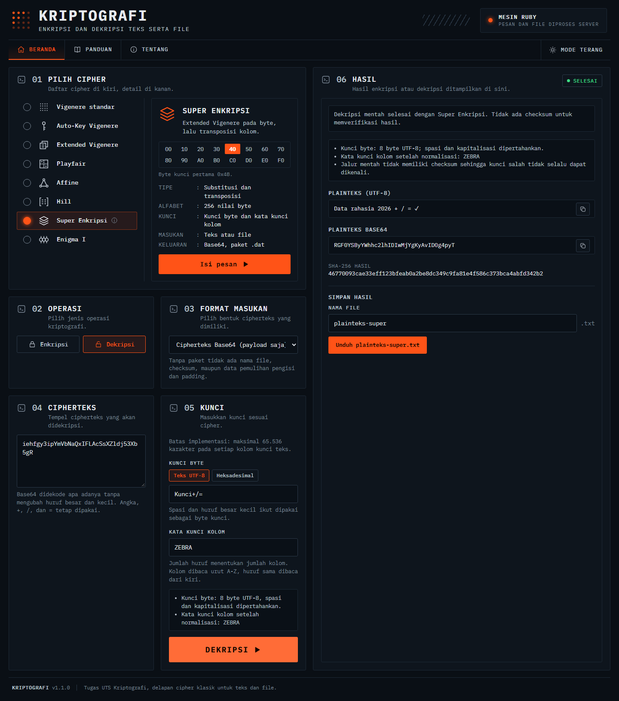

Super Enkripsi menerima Base64 payload mentah tanpa mengubah kapitalisasi atau simbolnya. Dekripsi mengembalikan Data rahasia 2026 + / = ✓, dengan status dekripsi mentah karena metadata paket tidak diberikan.

## Gambar 5. dekripsi-mentah-playfair

Dekripsi huruf mentah Playfair mengembalikan HIDETHEGOLDINTHETREXESTUMP. Huruf X pengisi tetap terlihat karena masukan mentah tidak membawa metadata posisi pengisi.

## Gambar 6. file-affine-dekripsi

Paket Affine diunggah pada konteks browser baru dan memulihkan `video-contoh.webm` menjadi 43.791 byte. SHA-256 yang terlihat adalah `e54006297a99c9d8ced50d331f7f6c989238bab2bc5041890397f60b858366ed`. File unduhan telah dibandingkan byte demi byte dan identik dengan file asal.

## Gambar 7. file-affine-enkripsi

Affine memproses seluruh byte `video-contoh.webm`, berukuran 43.791 byte, dengan a `7`, b `10`. Panel hasil menampilkan Base64 payload dan unduhan paket .dat.

## Gambar 8. file-autokey-dekripsi

Paket Auto-Key Vigenere diunggah pada konteks browser baru dan memulihkan `gambar-contoh.png` menjadi 13.519 byte. SHA-256 yang terlihat adalah `c2cd2cf09c21cde6bb3443a1c5156bd8d51c34556a637710c0570a9f031feec7`. File unduhan telah dibandingkan byte demi byte dan identik dengan file asal.

## Gambar 9. file-autokey-enkripsi

Auto-Key Vigenere memproses seluruh byte `gambar-contoh.png`, berukuran 13.519 byte, dengan primer `UTSKRIPTO`. Panel hasil menampilkan Base64 payload dan unduhan paket .dat.

## Gambar 10. file-enigma-i-dekripsi

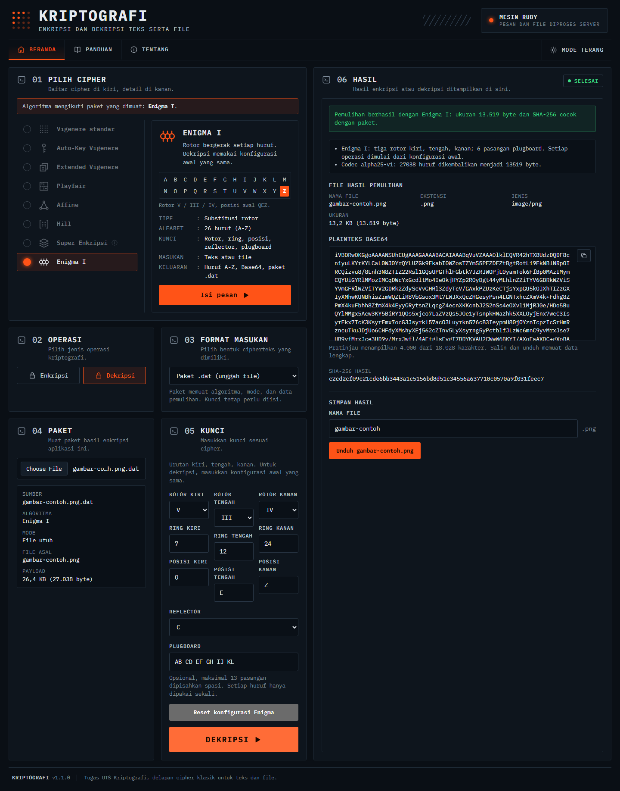

Paket Enigma I diunggah pada konteks browser baru dan memulihkan `gambar-contoh.png` menjadi 13.519 byte. SHA-256 yang terlihat adalah `c2cd2cf09c21cde6bb3443a1c5156bd8d51c34556a637710c0570a9f031feec7`. File unduhan telah dibandingkan byte demi byte dan identik dengan file asal.

## Gambar 11. file-enigma-i-enkripsi

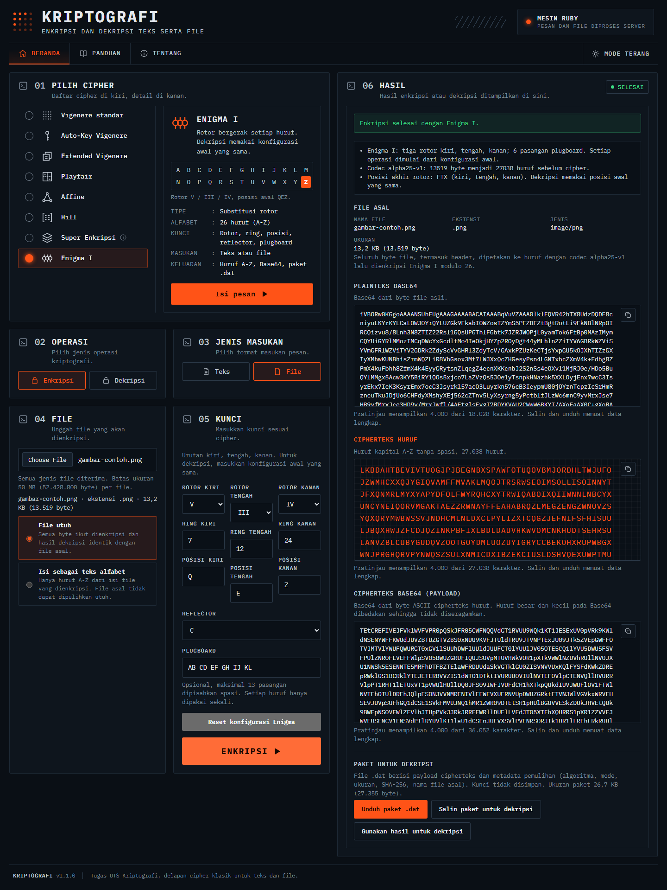

Enigma I memproses seluruh byte `gambar-contoh.png`, berukuran 13.519 byte, dengan rotor kiri/tengah/kanan `V III IV`, ring `7 12 24`, posisi awal `QEZ`, reflektor `C`, plugboard `AB CD EF GH IJ KL`. Panel hasil menampilkan Base64 payload dan unduhan paket .dat.

## Gambar 12. file-extended-vigenere-dekripsi

Paket Extended Vigenere diunggah pada konteks browser baru dan memulihkan `database-contoh.sqlite` menjadi 20.480 byte. SHA-256 yang terlihat adalah `c7676535471569066680dfaa23bc3267d6e1abad1ea5f746f3b6609ea7358669`. File unduhan telah dibandingkan byte demi byte dan identik dengan file asal.

## Gambar 13. file-extended-vigenere-enkripsi

Extended Vigenere memproses seluruh byte `database-contoh.sqlite`, berukuran 20.480 byte, dengan kunci byte `Kunci Byte 2026!`, format `text`. Panel hasil menampilkan Base64 payload dan unduhan paket .dat.

## Gambar 14. file-hill-dekripsi

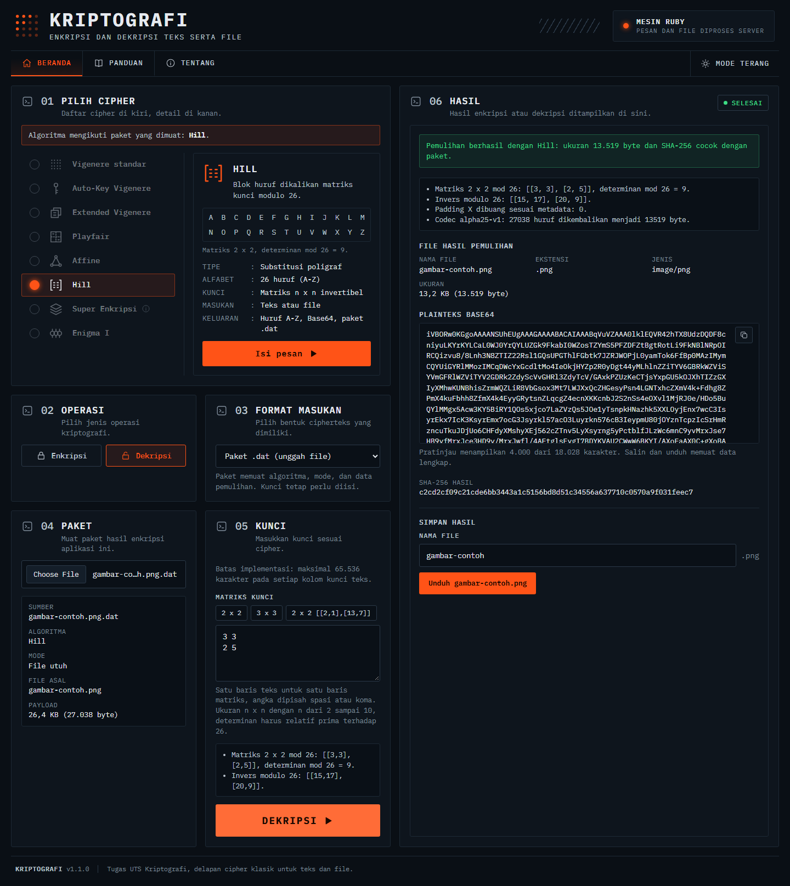

Paket Hill diunggah pada konteks browser baru dan memulihkan `gambar-contoh.png` menjadi 13.519 byte. SHA-256 yang terlihat adalah `c2cd2cf09c21cde6bb3443a1c5156bd8d51c34556a637710c0570a9f031feec7`. File unduhan telah dibandingkan byte demi byte dan identik dengan file asal.

## Gambar 15. file-hill-enkripsi

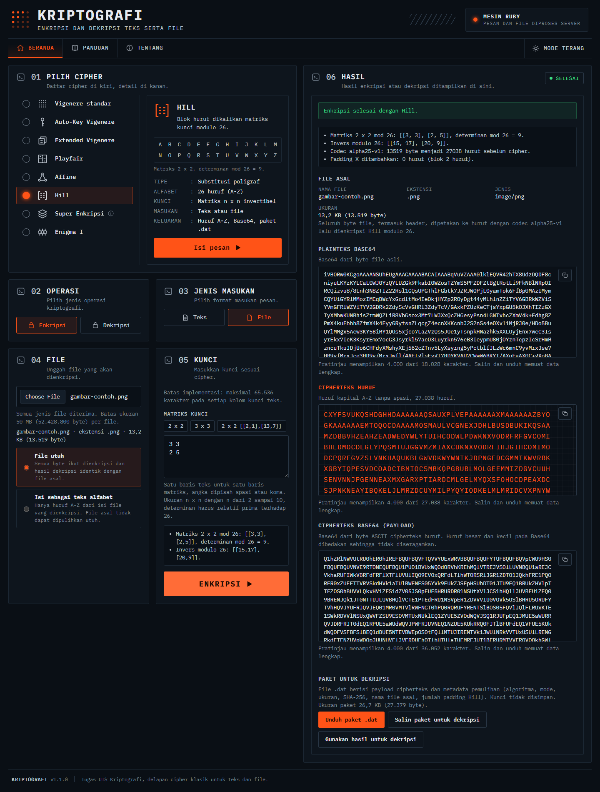

Hill memproses seluruh byte `gambar-contoh.png`, berukuran 13.519 byte, dengan matriks `3 3 / 2 5`. Panel hasil menampilkan Base64 payload dan unduhan paket .dat.

## Gambar 16. file-playfair-dekripsi

Paket Playfair diunggah pada konteks browser baru dan memulihkan `audio-contoh.wav` menjadi 16.044 byte. SHA-256 yang terlihat adalah `b5d248cecc2eb1eec4abdbb0b37512a027ac8d810c4c3d058f20aa844b095c46`. File unduhan telah dibandingkan byte demi byte dan identik dengan file asal.

## Gambar 17. file-playfair-enkripsi

Playfair memproses seluruh byte `audio-contoh.wav`, berukuran 16.044 byte, dengan kata kunci `MONARCHY`. Panel hasil menampilkan Base64 payload dan unduhan paket .dat.

## Gambar 18. file-super-dekripsi

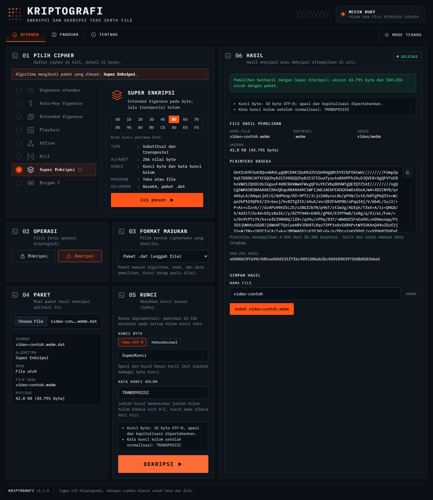

Paket Super Enkripsi diunggah pada konteks browser baru dan memulihkan `video-contoh.webm` menjadi 43.791 byte. SHA-256 yang terlihat adalah `e54006297a99c9d8ced50d331f7f6c989238bab2bc5041890397f60b858366ed`. File unduhan telah dibandingkan byte demi byte dan identik dengan file asal.

## Gambar 19. file-super-enkripsi

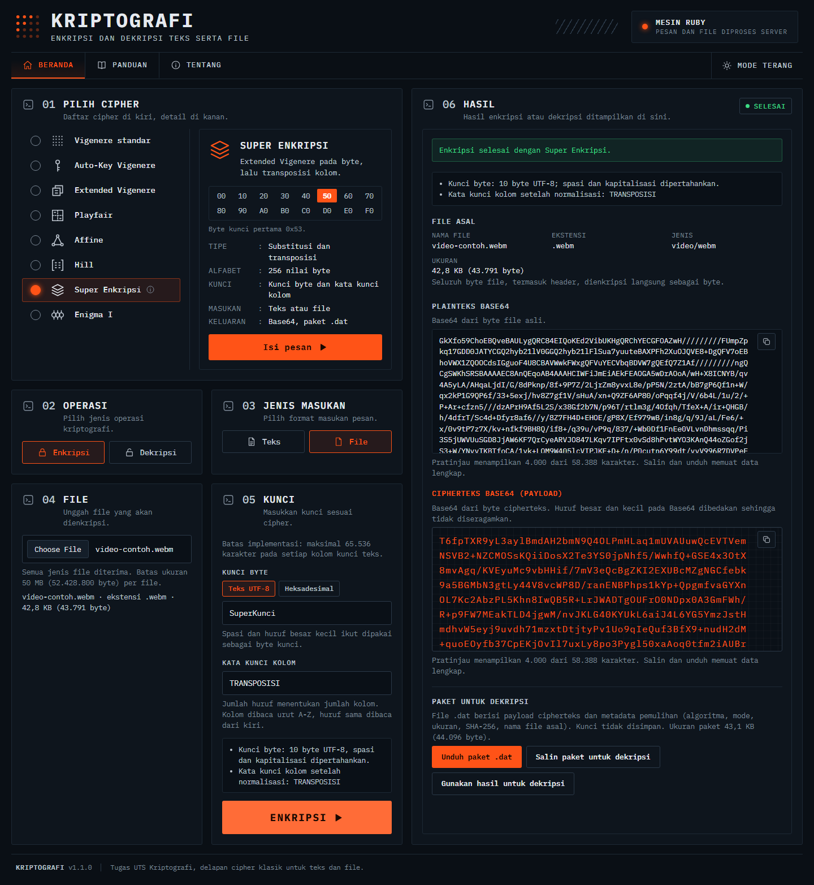

Super Enkripsi memproses seluruh byte `video-contoh.webm`, berukuran 43.791 byte, dengan kunci byte `SuperKunci`, format `text`, kunci kolom `TRANSPOSISI`. Panel hasil menampilkan Base64 payload dan unduhan paket .dat.

## Gambar 20. file-vigenere-dekripsi

Paket Vigenere standar diunggah pada konteks browser baru dan memulihkan `teks-contoh.txt` menjadi 263 byte. SHA-256 yang terlihat adalah `d13859ef429e1012ee1d7b50a4fab44631162d8e544ae38d8efbdcd81e163f68`. File unduhan telah dibandingkan byte demi byte dan identik dengan file asal.

## Gambar 21. file-vigenere-enkripsi

Vigenere standar memproses seluruh byte `teks-contoh.txt`, berukuran 263 byte, dengan kata kunci `KRIPTOGRAFI`. Panel hasil menampilkan Base64 payload dan unduhan paket .dat.

## Gambar 22. hasil-lama-ditandai

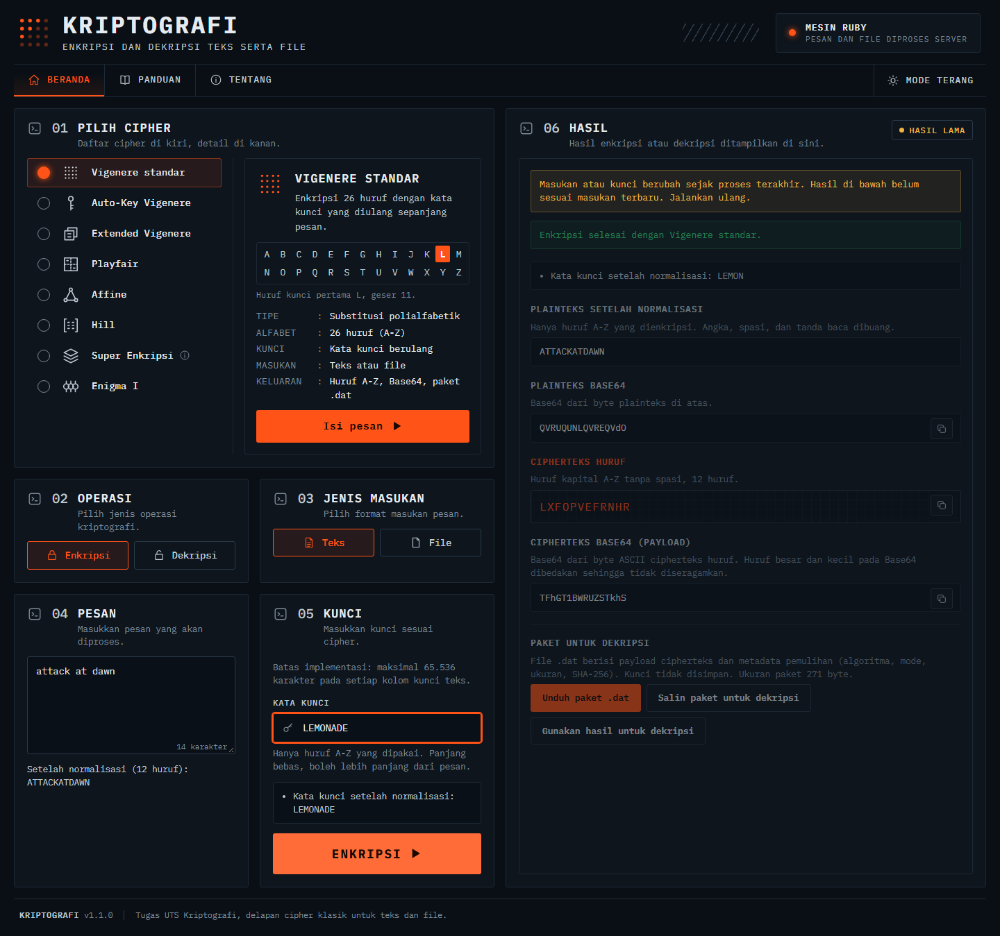

Setelah kunci Vigenere diganti dari LEMON menjadi LEMONADE, hasil sebelumnya diberi peringatan agar tidak dianggap berasal dari masukan terbaru.

## Gambar 23. info-super-enkripsi

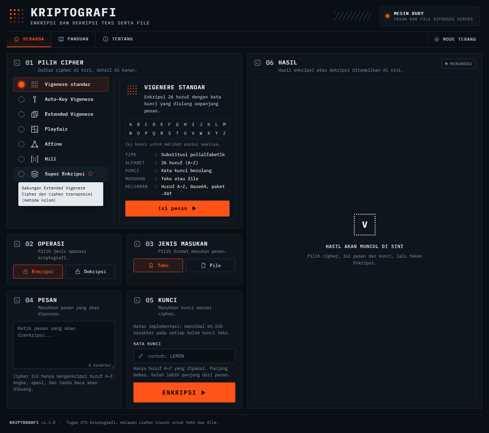

Keterangan Super Enkripsi menjelaskan gabungan Extended Vigenere dan transposisi kolom tanpa mengubah cipher yang sedang dipilih.

## Gambar 24. layar-sempit-enigma

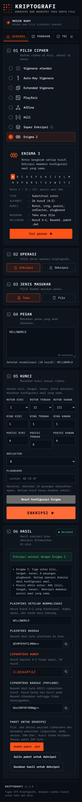

Formulir Enigma pada viewport 390 x 844 menampilkan konfigurasi rotor serta hasil ILBDAAMTAZ dari HELLOWORLD tanpa gulir horizontal.

## Gambar 25. layar-sempit

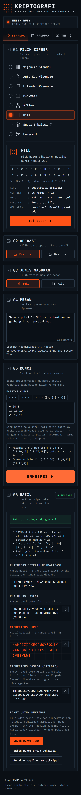

Formulir Hill dan hasil enkripsi pada viewport 390 x 844 dapat dibaca tanpa gulir horizontal. Hasil ini didukung pemeriksaan lebar dokumen dalam pengujian browser.

## Gambar 26. teks-affine-dekripsi

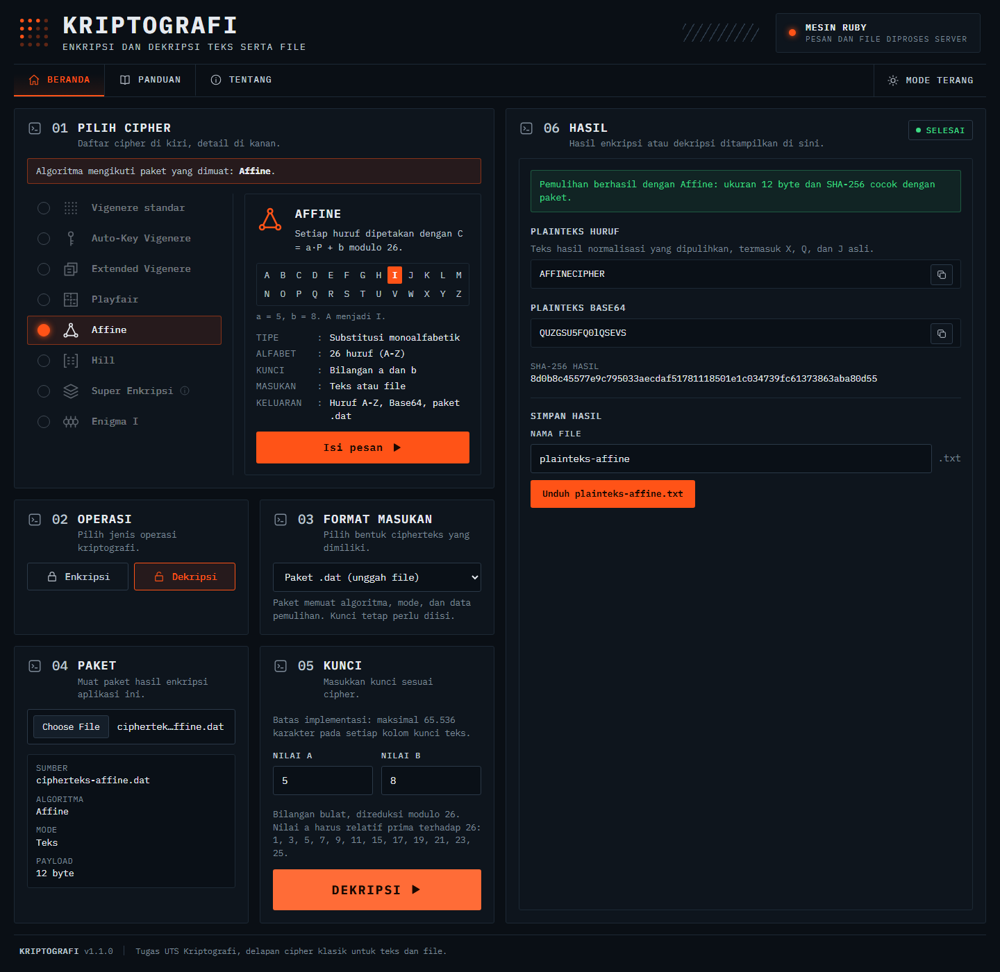

Paket teks Affine diunduh, kemudian dibuka pada konteks browser baru. Dengan kunci yang sama, keluaran yang terlihat adalah `AFFINECIPHER` dan status pemulihan berhasil.

## Gambar 27. teks-affine-enkripsi

Affine mengenkripsi `affine cipher` dengan a `5`, b `8`. Hasil huruf yang terlihat adalah `IHHWVCSWFRCP`.

## Gambar 28. teks-autokey-dekripsi

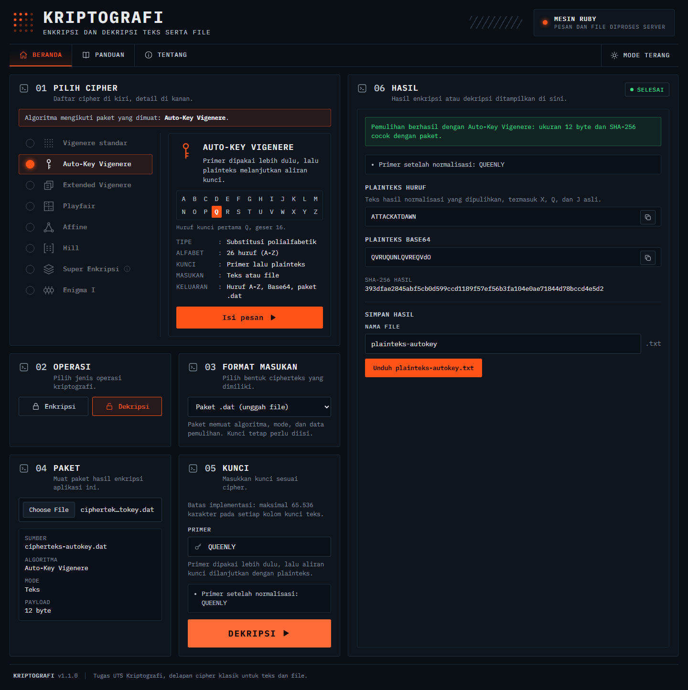

Paket teks Auto-Key Vigenere diunduh, kemudian dibuka pada konteks browser baru. Dengan kunci yang sama, keluaran yang terlihat adalah `ATTACKATDAWN` dan status pemulihan berhasil.

## Gambar 29. teks-autokey-enkripsi

Auto-Key Vigenere mengenkripsi `ATTACK AT DAWN` dengan primer `QUEENLY`. Hasil huruf yang terlihat adalah `QNXEPVYTWTWP`.

## Gambar 30. teks-enigma-i-dekripsi

Paket teks Enigma I diunduh, kemudian dibuka pada konteks browser baru. Dengan kunci yang sama, keluaran yang terlihat adalah `HELLOWORLD` dan status pemulihan berhasil.

## Gambar 31. teks-enigma-i-enkripsi

Enigma I mengenkripsi `Hello, world! 2026` dengan rotor kiri/tengah/kanan `I II III`, ring `1 1 1`, posisi awal `AAA`, reflektor `B`, plugboard (kosong). Hasil huruf yang terlihat adalah `ILBDAAMTAZ`.

## Gambar 32. teks-extended-vigenere-dekripsi

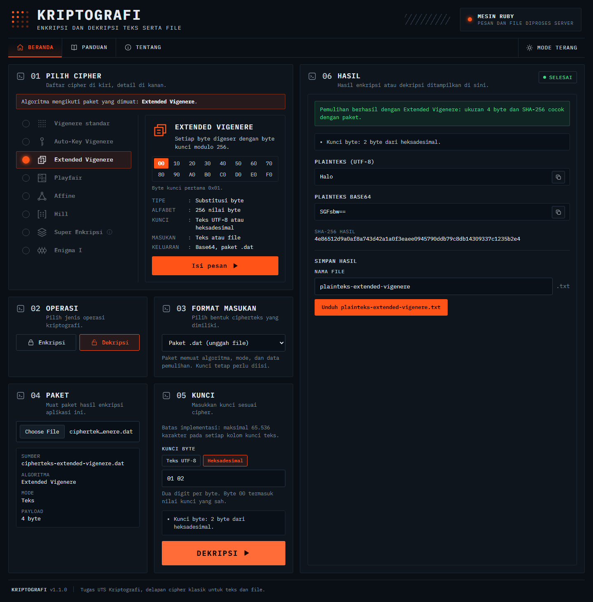

Paket teks Extended Vigenere diunduh, kemudian dibuka pada konteks browser baru. Dengan kunci yang sama, keluaran yang terlihat adalah `Halo` dan status pemulihan berhasil.

## Gambar 33. teks-extended-vigenere-enkripsi

Extended Vigenere mengenkripsi `Halo` dengan kunci byte `01 02`, format `hex`. Hasil Base64 payload yang terlihat adalah `SWNtcQ==`.

## Gambar 34. teks-hill-dekripsi

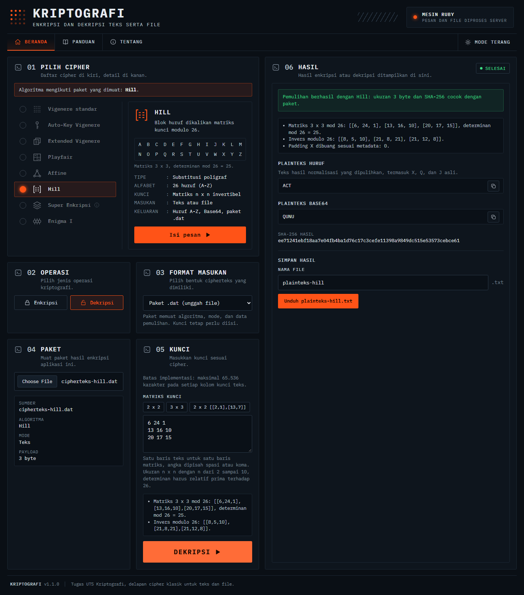

Paket teks Hill diunduh, kemudian dibuka pada konteks browser baru. Dengan kunci yang sama, keluaran yang terlihat adalah `ACT` dan status pemulihan berhasil.

## Gambar 35. teks-hill-enkripsi

Hill mengenkripsi `act` dengan matriks `6 24 1 / 13 16 10 / 20 17 15`. Hasil huruf yang terlihat adalah `POH`.

## Gambar 36. teks-playfair-dekripsi

Paket teks Playfair diunduh, kemudian dibuka pada konteks browser baru. Dengan kunci yang sama, keluaran yang terlihat adalah `HIDETHEGOLDINTHETREESTUMP` dan status pemulihan berhasil.

## Gambar 37. teks-playfair-enkripsi

Playfair mengenkripsi `Hide the gold in the tree stump` dengan kata kunci `PLAYFAIREXAMPLE`. Hasil huruf yang terlihat adalah `BMODZBXDNABEKUDMUIXMMOUVIF`.

## Gambar 38. teks-super-dekripsi

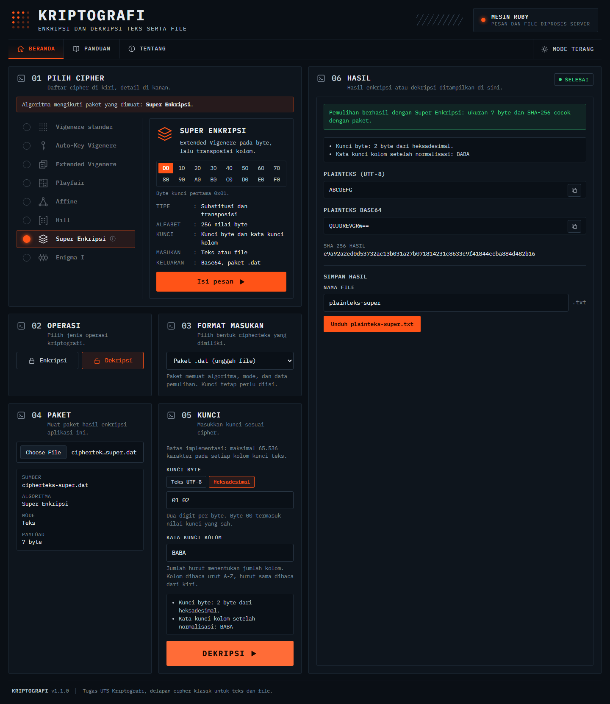

Paket teks Super Enkripsi diunduh, kemudian dibuka pada konteks browser baru. Dengan kunci yang sama, keluaran yang terlihat adalah `ABCDEFG` dan status pemulihan berhasil.

## Gambar 39. teks-super-enkripsi

Super Enkripsi mengenkripsi `ABCDEFG` dengan kunci byte `01 02`, format `hex`, kunci kolom `BABA`. Hasil Base64 payload yang terlihat adalah `REhGQkZESA==`.

## Gambar 40. teks-vigenere-dekripsi

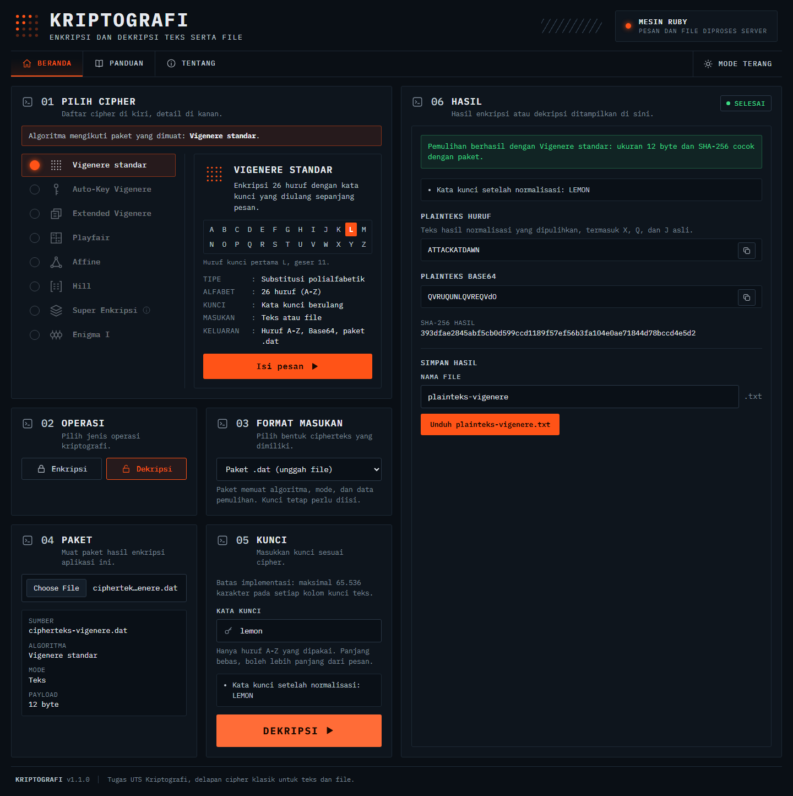

Paket teks Vigenere standar diunduh, kemudian dibuka pada konteks browser baru. Dengan kunci yang sama, keluaran yang terlihat adalah `ATTACKATDAWN` dan status pemulihan berhasil.

## Gambar 41. teks-vigenere-enkripsi

Vigenere standar mengenkripsi `attack at dawn` dengan kata kunci `lemon`. Hasil huruf yang terlihat adalah `LXFOPVEFRNHR`.

## Gambar 42. validasi-affine

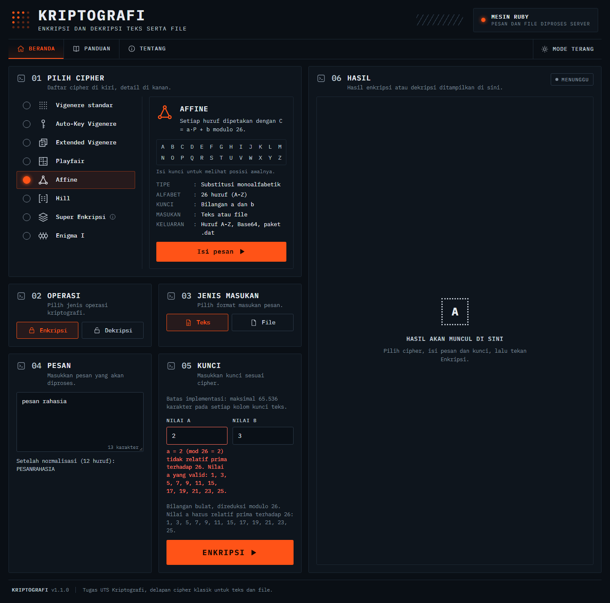

Formulir Affine menolak a=2 karena tidak relatif prima terhadap 26. Tidak ada hasil enkripsi yang diterbitkan.

## Gambar 43. validasi-enigma-plugboard

Formulir Enigma menolak plugboard AB AC karena huruf A digunakan pada lebih dari satu pasangan.

## Gambar 44. validasi-hill

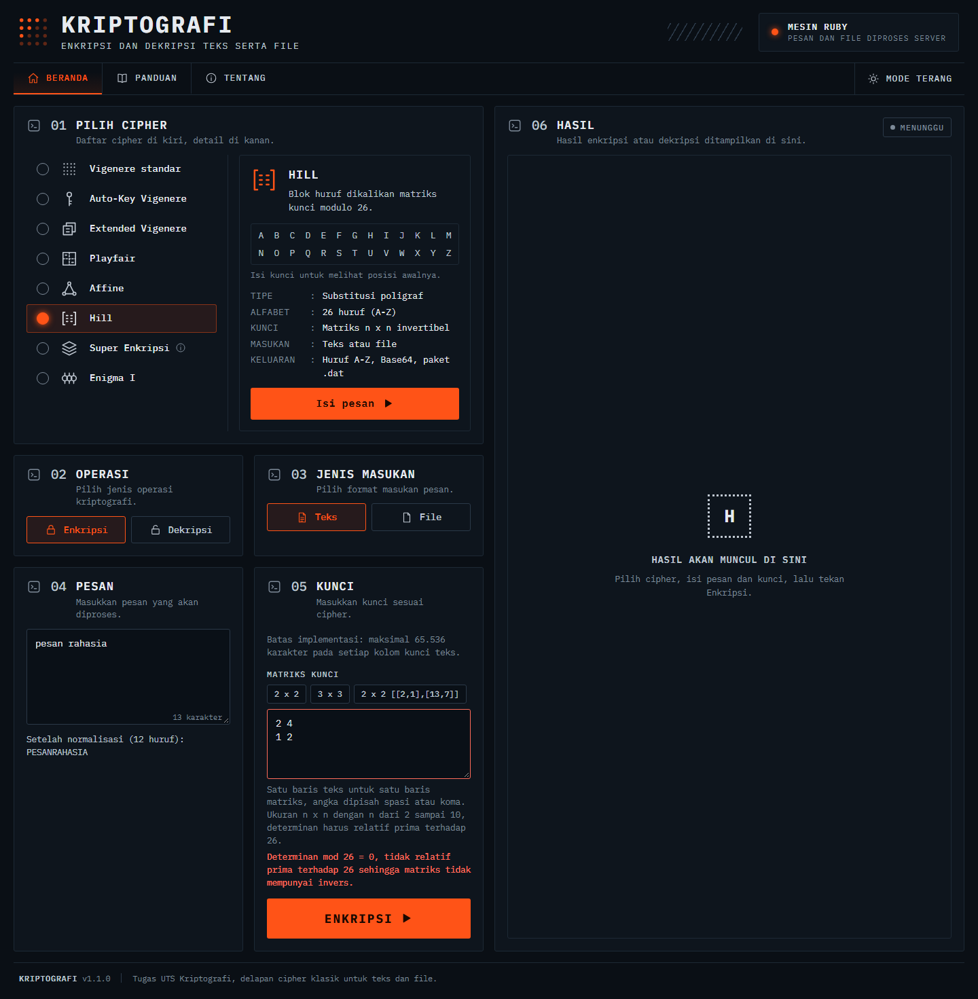

Formulir Hill menolak matriks 2 4 / 1 2 karena determinannya tidak mempunyai invers modulo 26.

## Gambar 45. validasi-kunci-salah

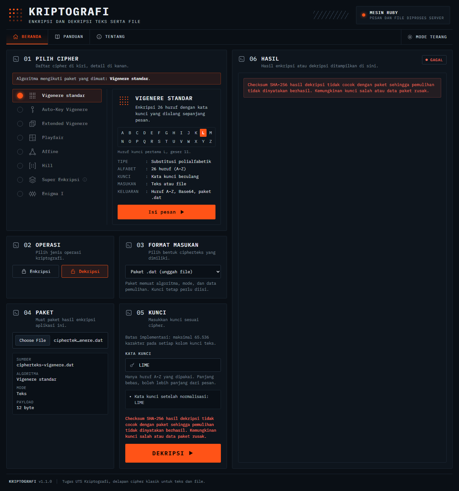

Paket Vigenere yang dibuat dengan LEMON didekripsi memakai LIME. Ketidakcocokan SHA-256 menghasilkan pesan kesalahan, sehingga hasil tidak dinyatakan berhasil.
